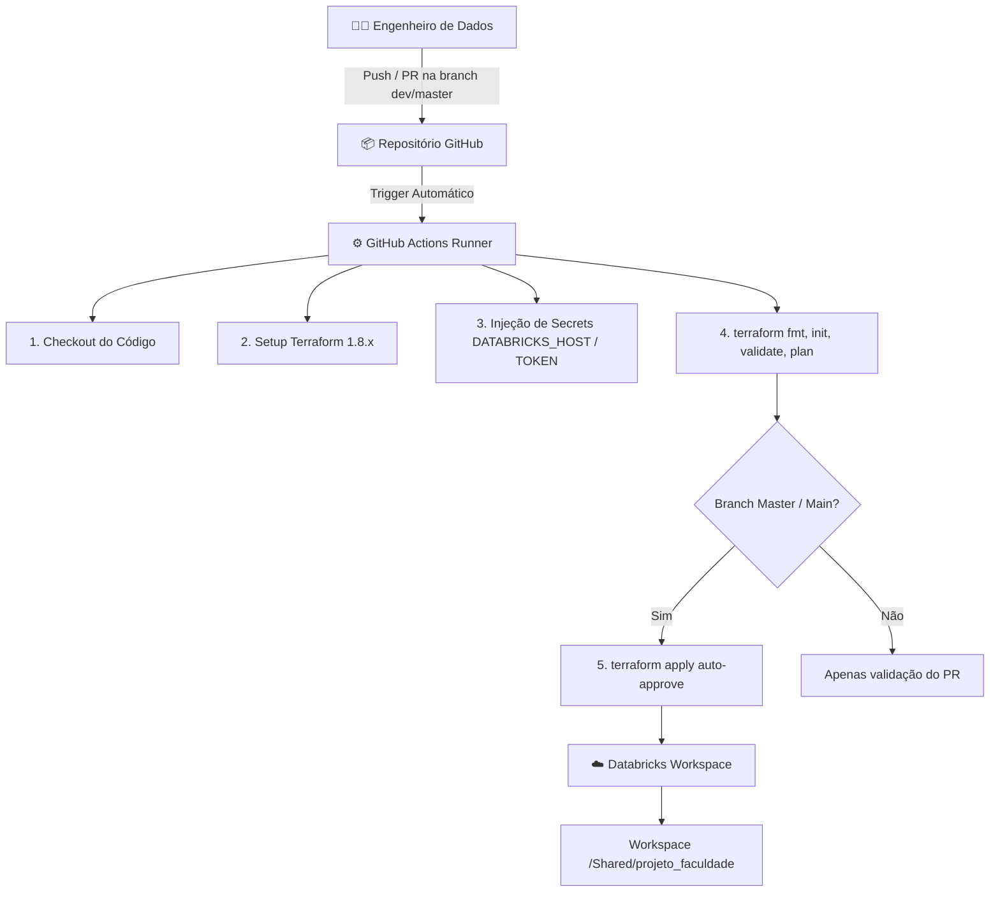
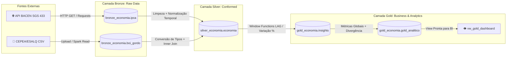

# 🚀 Data Lakehouse & CI/CD IaC no Databricks

<p align="center">
  
  
  
  
  
  
</p>

Pipeline completo de Engenharia de Dados de ponta a ponta implementando **Arquitetura Medalhão (Lakehouse)** no **Databricks**, provisionamento declarativo com **Infrastructure as Code (IaC) via Terraform** e esteira automatizada de **CI/CD com GitHub Actions**.

---

## 📌 Contexto de Negócio & Problema

O agronegócio é um dos pilares mais relevantes da economia brasileira, e a arroba do boi gordo é um termômetro direto desse mercado. Uma dúvida constante no mercado financeiro e agropecuário é:
> **"A variação no preço do boi gordo acompanha a inflação oficial (IPCA), supera-a ou diverge historicamente?"**

Este projeto desenvolve uma esteira de dados analítica e resiliente para extrair, padronizar, cruzar e gerar indicadores estatísticos (incluindo correlação de Pearson e divergência percentual) entre o **IPCA (Banco Central)** e as cotações do **Boi Gordo (CEPEA/ESALQ)**.

---

## 🏛️ Arquitetura da Solução

<p align="center">
  
</p>

### Fluxo de CI/CD e Infraestrutura (DevOps / DataOps)



---

## 🔄 Fluxo de Dados: Arquitetura Medalhão (Lakehouse)



---

## 📂 Estrutura do Repositório

```text
projeto-databricks-iac/
├── .github/
│   └── workflows/
│       └── deploy.yml              # Pipeline CI/CD (Lint, Plan e Apply automático)
├── terraform/
│   ├── versions.tf                 # Provider Databricks e travas de versão
│   ├── variables.tf                # Variáveis parametrizáveis de ambiente
│   ├── main.tf                     # Recursos: diretórios e deploy dinâmico de notebooks
│   ├── outputs.tf                  # Saídas com caminhos dos notebooks implantados
│   └── terraform.tfvars.example    # Template seguro para execução local
├── docs/
│   └── images/
│       └── projeto_iac_git_databricks.jfif # Diagrama visual da arquitetura
├── notebooks/
│   ├── 00.config/
│   │   └── config.py               # Configurações de Catálogo e Schemas (Unity Catalog)
│   ├── 01.bronze/
│   │   ├── boi_gordo_bronze.py     # Ingestão e versionamento da cotação do Boi Gordo
│   │   └── ipca_bronze.py          # Ingestão via API REST do IPCA com fallback resiliente
│   ├── 02.silver/
│   │   └── economia_silver.py      # Harmonização temporal (yyyy-MM), tipagem e Inner Join
│   └── 03.gold/
│       └── gold_insights.py        # Window Functions, métricas globais e views analíticas
├── .gitignore                      # Proteção de arquivos sensíveis (*.tfstate, secrets, .env)
├── spec.md                         # Especificação técnica completa de engenharia
└── README.md                       # Documentação executiva e técnica do projeto
```

---

## 🛠️ Tecnologias e Ferramentas

| Categoria | Ferramenta | Finalidade |
| :--- | :--- | :--- |
| **Plataforma de Dados** | **Databricks** | Execução de computação distribuída e governança com Unity Catalog |
| **Processamento Distribuído** | **Apache Spark (PySpark)** | Transformação de grandes volumes em memória e operações analíticas |
| **Formato de Armazenamento** | **Delta Lake** | Suporte a transações ACID, time-travel e versionamento de dados |
| **Infraestrutura como Código** | **Terraform** | Provisionamento declarativo de diretórios e notebooks no workspace |
| **Automação & CI/CD** | **GitHub Actions** | Esteira automatizada de lint, validação e deploy contínuo |
| **Linguagem Principal** | **Python / Spark SQL** | Scripts de ingestão, engenharia de features e consultas analíticas |
| **Controle de Versão** | **Git / GitHub** | Estratégia de branching baseada em GitFlow (`dev` e `master`) |

---

## 📓 Detalhamento dos Notebooks e Camadas

### ⚙️ `00.config/config.py` — Governança e Inicialização
- Define os namespaces no Unity Catalog (`workspace`).
- Garante a criação idempotente dos schemas: `bronze_economia`, `silver_economia` e `gold_economia`.
- Ativa a governança centralizada no catálogo.

### 🥉 Camada Bronze — Ingestão Bruta e Resiliência
- **`01.bronze/ipca_bronze.py`**:
  - Consome a API pública do Banco Central do Brasil (Série SGS 433).
  - Implementa mecanismo de fallback inteligente caso o cluster execute em ambiente restrito de rede.
  - Adiciona metadados de auditoria (`data_coleta = current_timestamp()`) e persiste em Delta Lake.
- **`01.bronze/boi_gordo_bronze.py`**:
  - Ingestão das séries históricas de cotações agropecuárias da ESALQ/CEPEA.
  - Carimbo de auditoria e persistência Delta.

### 🥈 Camada Silver — Higienização e Cruzamento
- **`02.silver/economia_silver.py`**:
  - Conversão e normalização de datas heterogêneas (`MM/yyyy` e `dd/MM/yyyy`) para padrão unificado mensal (`yyyy-MM` / competência no primeiro dia do mês).
  - Tratamento de valores decimais e garantia de tipagem estrita (`DoubleType`, `DateType`).
  - Execução de **Inner Join temporal**, gerando a visão unificada `silver_economia.economia`.

### 🥇 Camada Gold — Agregações Analíticas e Insights
- **`03.gold/gold_insights.py`**:
  - Cálculo de variações percentuais mensais usando **Window Functions** (`F.lag` ordenado por data).
  - Construção da tabela analítica `gold_analitico` com:
    - `correlacao_global`: Coeficiente de Correlação de Pearson entre inflação e cotação do boi (`CORR() OVER ()`).
    - `destaque`: Classificação categórica de qual indicador cresceu mais no período.
    - `classe_impacto`: Nível de divergência entre os indicadores (Alta, Média ou Baixa).
    - Médias móveis e globais consolidadas.
  - Disponibilização da View `vw_gold_dashboard` para conexão direta com ferramentas de BI (Power BI, Tableau, Metabase).

---

## 🔐 Segurança e Boas Práticas Adotadas

- 🛡️ **Zero Hardcoded Secrets**: Nenhuma credencial, token (`DATABRICKS_TOKEN`) ou endpoint sensível está versionado no código.
- 🔒 **GitHub Secrets**: Todas as variáveis confidenciais são injetadas dinamicamente no runner do GitHub Actions via secrets de repositório.
- 🧹 **.gitignore Abrangente**: Bloqueio total de arquivos locais de estado do Terraform (`*.tfstate`), variáveis (`*.tfvars`), arquivos de ambiente (`.env`) e caches de execução.
- 🧪 **Pipeline Seguro**: Branches `dev` apenas validam sintaxe e planos (`terraform plan`), garantindo que apenas a branch principal realize modificações no ambiente (`terraform apply`).

---

## 🚀 Como Replicar este Projeto

### 1. Clonar o Repositório
```bash
git clone https://github.com/Ronaldo192/projeto-databricks-iac.git
cd projeto-databricks-iac
```

### 2. Configurar as Secrets no GitHub
No seu repositório do GitHub, vá em **Settings > Secrets and variables > Actions** e adicione:
- `DATABRICKS_HOST`: URL do seu workspace Databricks (ex: `https://community.cloud.databricks.com`).
- `DATABRICKS_TOKEN`: Token de Acesso Pessoal (PAT) gerado no menu de configurações do usuário no Databricks.

### 3. Deploy Automático
Faça qualquer alteração e envie para a branch principal (`master` ou `main`):
```bash
git add .
git commit -m "feat: minha nova feature"
git push origin master
```
O workflow do GitHub Actions será disparado automaticamente, executando o planejamento e a implantação dos diretórios e notebooks no Databricks.

---

## 👨‍💻 Autor

Desenvolvido por **Ronaldo Benedito**.

[](https://www.linkedin.com/in/ronaldo-santos-bene)
[](https://github.com/Ronaldo192)

---
*Gostou do projeto? Deixe uma ⭐️ no repositório!*
